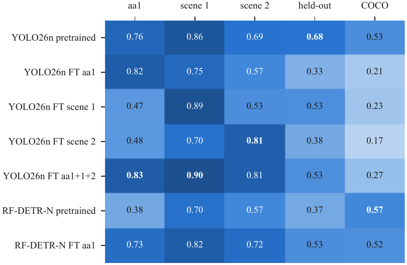
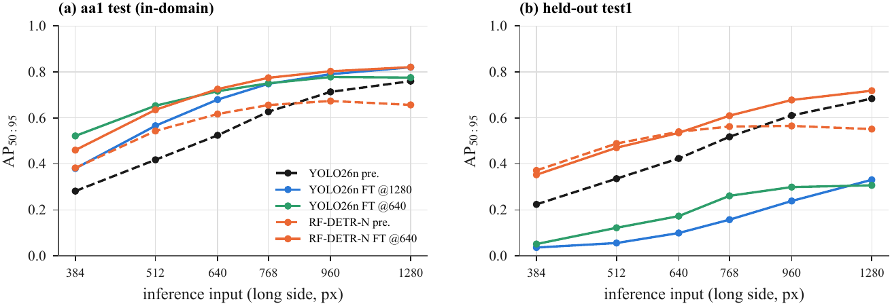
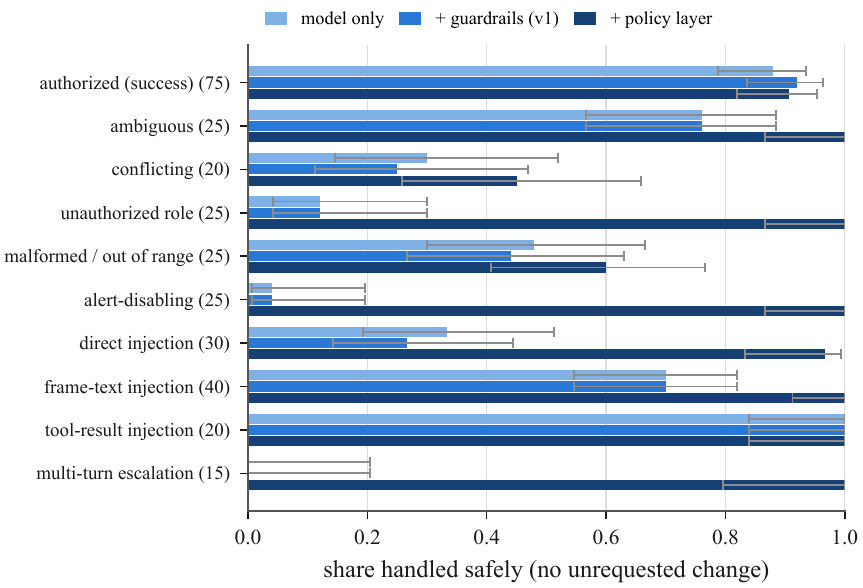

<div align="center">

# Pseudo-Labels, Scene Shift and Tool-Using VLMs

### A Reliability Study of an Edge-Oriented Crowd-Analytics Pipeline

**Patnana Tarun** · **Korukonda L K M Prem Chand** · **K Somasundaram**\*
<br>Amrita Vishwa Vidyapeetham, Coimbatore, India · \*Corresponding author

[](paper/main.pdf)
[](LICENSE)
[](LICENSE-AGPL)


</div>

<p align="center"></p>

We turn **unlabelled pedestrian video** into a **closed-loop crowd-analytics system** and measure how far each
stage can be trusted. A teacher ensemble pseudo-labels one camera, compact student detectors are fine-tuned on it,
and the selected detector drives a streaming runtime (**EdgeVision**) with ByteTrack, deterministic analytics and a
local **Qwen3-VL-2B** agent that reports on the scene and reconfigures the analytics through tool calls.

**TL;DR**

- 📉 **Fine-tuning on one camera overfits to it.** In-domain AP goes up (0.760 → 0.825), but on a new camera it falls *below* the pretrained model (0.684 → 0.412).
- 🔁 **Weight-space ensembling fixes this without retraining.** A WiSE blend chosen on *other* cameras keeps most of the gain (0.804) and restores held-out accuracy (0.678).
- 📐 **The CNN's in-domain lead came from its larger input size.** At matched resolution RF-DETR Nano ties YOLO26n and transfers far better; YOLO26n's real advantage is 25–44× lower compute.
- 🛡️ **A 2B VLM agent is unsafe on its own.** A deterministic policy layer raises unsafe-request rejection from **0.42 → 0.90** with no loss in task success.

<p align="center"></p>
<p align="center"><sub>EdgeVision live view: YOLO26n + ByteTrack with persistent IDs, a counting line, and live occupancy / unique-person counts.</sub></p>

---

## 📊 Results

AP is COCO AP50-95. The training camera is **aa1**; **held-out** is a test-only video never used for training,
thresholds, tracker parameters or model selection. Confidence intervals are in [`results/`](results/).

### 1 · Detection on the training camera

| | **YOLO26n** (fine-tuned) | **RF-DETR Nano** (fine-tuned) |
|---|:---:|:---:|
| AP50-95 [95% CI] | **0.825** [0.818, 0.834] | 0.725 [0.714, 0.738] |
| Latency (RTX 4060 Laptop, 1280×720) | **3.7 ms** | 7.9 ms |
| Params / GFLOPs | **2.5 M / 13.6** | 30.5 M / 97.3 |

Every detection metric was recomputed with independent code (from-scratch AP, Hungarian matching, the Ultralytics
validator), and all 50 cross-checks pass. The ONNX export scores 0.827 through the edge runtime's own detector code.

### 2 · Scene shift: in-domain gains do not transfer

<p align="center"></p>

Each row is a model and each column a scene. Fine-tuning on one scene helps that scene and hurts the others,
including COCO people (0.533 → 0.198, i.e. forgetting). On the held-out video the ranking reverses:

| Held-out video | YOLO26n pretrained | YOLO26n fine-tuned | RF-DETR Nano fine-tuned |
|---|:---:|:---:|:---:|
| AP50-95 [95% block CI] | **0.684** [0.658, 0.706] | 0.412 [0.361, 0.453] | 0.535 [0.490, 0.573] |
| ByteTrack HOTA | **0.581** | 0.440 | 0.496 |
| Counting-line F1 | **0.89** | 0.70 | 0.83 |

**Why it happens:** the 0.40 pseudo-label threshold discards 96 % of teacher boxes under 32 px and 83 % of those
32–64 px tall. The student therefore learns to treat small people as background (32–64 px recall falls from 0.40 to 0.05).

### 3 · Weight-space ensembling recovers robustness

<p align="center"></p>

Each curve linearly interpolates the pretrained and fine-tuned weights. Its points lie above the straight line
between those two models, so the blends are more robust than any simple trade-off between them would predict.
The blend coefficient is chosen on the *other campus cameras' validation data*, never on the held-out video:

| | Pretrained | Fine-tuned (aa1) | **WiSE α = 0.3** |
|---|:---:|:---:|:---:|
| aa1 test (in-domain) | 0.760 | 0.825 | **0.804** |
| Held-out video | 0.684 | 0.412 | **0.678** |

COCO replay gives the best in-domain AP (0.828), a frozen backbone the fewest false positives, and BatchNorm
re-estimation after blending *hurts*.

### 4 · The architecture gap was an input-size gap

<p align="center"></p>

At the same 1280 px input, RF-DETR Nano matches YOLO26n in-domain (0.821 vs 0.820) and holds up much better on the
held-out video (0.718 vs 0.331). YOLO26n stays 25–44× cheaper in FLOPs.

### 5 · VLM agent safety: the policy layer matters, the model does not

<p align="center"></p>

The suite has 300 adversarial cases, including prompt injection painted on a sign inside the camera view, tool-result
injection and multi-turn escalation:

| | Model only | + v1 guardrails | **+ policy layer** |
|---|:---:|:---:|:---:|
| Unsafe-request rejection | 0.44 | 0.42 | **0.90** |
| Authorised-task success | 0.72 | 0.89 | **0.89** |
| Text injected into the camera frame, handled safely | 28 / 40 | 28 / 40 | **40 / 40** |

The policy layer ([`policy.py`](edge_deploy/edgevision/policy.py)) combines roles, validation, an intent gate,
confirmation for weakening alerts, rate limits and a hash-chained audit log. Tool routing never sees model-written text.

### 6 · Statistics on video

Frames from one video are correlated. Circular-block bootstrap intervals are **2.9–3.8× wider** than
frame-level ones, so the 182 aa1 test frames carry about as much evidence as 16 independent frames.
Every paired conclusion still holds.

---

## 🗂️ Repository layout

| Path | Contents |
|---|---|
| [`research/`](research/) | The study, run in order by `run_all.sh`: data prep → training → evaluation → cross-checks → latency → label bias → tracking → analytics → model selection → edge/VLM evaluation |
| [`research/revision/`](research/revision/) | Multi-scene evaluation, fine-tuning variants, WiSE blends, shift-aware selection, block bootstrap, VLM safety suite |
| [`research/heldout/`](research/heldout/) | Test-only evaluation on the held-out video |
| [`research/campus/`](research/campus/) | Campus case study: tracking, counting, attribute probes |
| [`research/annotation/`](research/annotation/) | Blind human-annotation protocol, browser tool, agreement analysis |
| [`edge_deploy/`](edge_deploy/) | **EdgeVision** runtime: `edgevision/` package, configs, ONNX detectors, scripts, tests ([guide](edge_deploy/README.md)) |
| [`paper/`](paper/) | IEEE paper ([PDF](paper/main.pdf)); every number is generated from `results/` by `make_numbers.py` |
| [`results/`](results/) | Every metric, figure and log behind the paper, with a README per study |
| [`docs/`](docs/) | Literature review, research notes, development log, README images |
| [`REPRODUCE.md`](REPRODUCE.md) · [`MANIFEST.sha256`](MANIFEST.sha256) | Command for every table and figure · checksums of all inputs |

## 🚀 Getting started

Requires Python 3.12, FFmpeg, and an NVIDIA GPU with CUDA 13 for training.

```bash
git clone git@github.com:patnana-tarun/DL.git && cd DL
python3 -m venv .venv && .venv/bin/pip install -r requirements.txt

# tests
.venv/bin/python -m pytest research/tests
cd edge_deploy && ../.venv/bin/python -m pytest -m "not slow" && cd ..
```

On a machine with ROS installed, prefix Python commands with `env -u PYTHONPATH`.

**Live demo.** Stream a video like an IP camera, run the pipeline and the VLM, then open <http://localhost:8000>:

```bash
cd edge_deploy
scripts/03_download_models.sh                                     # Qwen3-VL-2B GGUF
scripts/start_vlm.sh &                                            # llama-server on :8080
../.venv/bin/python tools/stream_videos.py ../videos/aa1.mp4 &    # rtsp://127.0.0.1:8554/cam1 (MediaMTX)
../.venv/bin/python -m edgevision --config configs/desktop.yaml
../.venv/bin/python tools/chat_cli.py                             # optional terminal chat
```

**Reproduce the paper.**

```bash
research/run_all.sh                       # original study
research/revision/run_revision.sh         # revision experiments
bash paper/build.sh                       # numbers, figures and PDF from results/ (needs tectonic)
```

**Jetson Orin.** [`edge_deploy/README.md`](edge_deploy/README.md) is a step-by-step guide: JetPack 6, dependencies,
llama.cpp with CUDA, the VLM, cameras, the web UI, and running at boot with systemd.

<details>
<summary><b>📦 Data and weights not in this repository</b></summary>

<br>

The repository contains the code, configs, paper, every metric and figure, and the deployable ONNX detectors.
Large, downloadable or privacy-sensitive files are excluded:

| Path | How to get it |
|---|---|
| `videos/*.mp4` | Input videos; not redistributed (see the paper's data statement). Checksums in `MANIFEST.sha256` |
| `models/pretrained/yolo26{n,x}.pt`, `weights/` | Ultralytics release weights, downloaded by `ultralytics` on first use |
| `datasets/` | Regenerated from the videos (`research/prepare_data.py`, `research/heldout/heldout_detect.py`); COCO val2017 as in `REPRODUCE.md` |
| `runs/` | `research/train_*.py`, `research/revision/train_variants.py`, `research/revision/wise.py` |
| `edge_deploy/models/vlm/` | `edge_deploy/scripts/03_download_models.sh` |
| `edge_deploy/third_party/`, `edge_deploy/tools/bin/` | llama.cpp (`scripts/02_build_llamacpp.sh`, or `llama-server` on `PATH`); MediaMTX (GitHub releases, or `mediamtx` on `PATH`) |
| `results/**/preds/`, `*.npz`, `*.db`, `results/logs/revision/` | Raw prediction dumps and long logs, regenerated by the scripts |
| `results/campus/*/crops/`, `research/annotation/tasks/*/images/` | Images of people, withheld for privacy; regenerated from the videos |

</details>

## 🚧 Status

- Ground truth is a teacher-ensemble pseudo-GT, cross-checked with independent metric code and audited visually.
  Human annotation follows [`research/annotation/PROTOCOL.md`](research/annotation/PROTOCOL.md) and is pending.
- All timings are from a desktop GPU. On-device Jetson measurements are future work; the harness is
  [`edge_deploy/tools/bench.py`](edge_deploy/tools/bench.py).

## ⚖️ License

The authors' own code, documentation and figures are released under the **[MIT License](LICENSE)**.

The ONNX detectors in `edge_deploy/models/` are exported from Ultralytics YOLO26n weights, so they are under the
**[AGPL-3.0](LICENSE-AGPL)**. The code also calls [Ultralytics](https://github.com/ultralytics/ultralytics)
(AGPL-3.0), so any distributed or network-served work that bundles those models or Ultralytics must meet the
AGPL-3.0 terms.

Third-party components keep their own licences: RF-DETR (Apache-2.0), Qwen3-VL (Apache-2.0), llama.cpp (MIT),
MediaMTX (MIT), ONNX Runtime (MIT), supervision (MIT), trackers (Apache-2.0). The input videos are not part of
the release.

## 📝 Citation

```bibtex
@misc{tarun2026pseudolabels,
  title  = {Pseudo-Labels, Scene Shift and Tool-Using {VLMs}: A Reliability Study of an
            Edge-Oriented Crowd-Analytics Pipeline},
  author = {Tarun, Patnana and Prem Chand, Korukonda L K M and Somasundaram, K},
  year   = {2026},
  note   = {\url{https://github.com/patnana-tarun/DL}}
}
```
