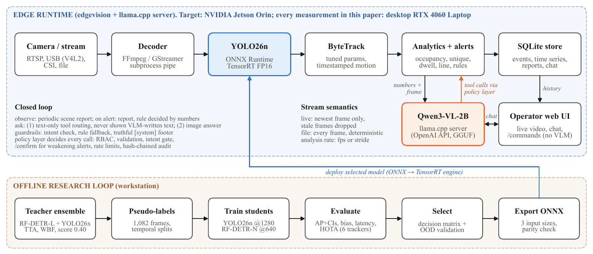
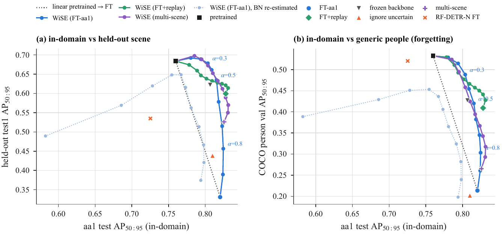

# Cross-Camera Generalization of Pseudo-Label Fine-Tuned Person Detectors and Policy-Constrained VLM Control for Edge Crowd Analytics

Patnana Tarun, Korukonda L K M Prem Chand, K Somasundaram (corresponding author)
Amrita Vishwa Vidyapeetham, Coimbatore, India

Paper: [paper/main.pdf](paper/main.pdf)

<p align="center"></p>

A common way to adapt a crowd-analytics system to a new camera is to pseudo-label its footage with large teacher
detectors and fine-tune a small student detector on the result. Earlier work reports the gain on the adapted camera.
This repository measures what that adaptation costs on other cameras, shows how to repair it without labels from the
target camera, and tests how safe it is to let a small vision-language model (VLM) operate the system through tool
calls.

## Main results

AP is COCO AP50-95. The adaptation video is aa1. test1 is a test-only video that was never used for training,
thresholds, tracker parameters or model selection.

| YOLO26n | aa1 | scene 1 | scene 2 | test1 | COCO people |
|---|:---:|:---:|:---:|:---:|:---:|
| pretrained | 0.760 | 0.860 | 0.689 | 0.684 | 0.533 |
| fine-tuned on aa1 pseudo-labels | 0.825 | 0.743 | 0.580 | 0.412 | 0.198 |
| weight average, alpha = 0.3 | 0.804 | 0.858 | 0.676 | 0.678 | 0.488 |

- Fine-tuning on one camera helps that camera and hurts every other camera and COCO people, each time to below the
  pretrained weights. The same happens when either campus scene is the adaptation scene.
- The 0.40 pseudo-label threshold drops 96% of teacher boxes on people under 32 px, so the student learns that
  distant people are background. Marking those boxes as ignore regions recovers part of the loss; the rest is
  forgetting.
- Averaging pretrained and fine-tuned weights, with the coefficient chosen on other cameras' validation data,
  restores most of the transfer at no cost. Re-estimating BatchNorm statistics after averaging makes it worse.
  The runtime ships this averaged model by default (`edge_deploy/models/yolo26n_wise_person_*.onnx`).
- At equal input size RF-DETR Nano matches YOLO26n on aa1 (0.821 vs 0.820 at 1280 px) and transfers much better
  (0.718 vs 0.331 on test1). YOLO26n's advantage is 24-44x less compute.
- Qwen3-VL-2B repeats whatever count it is given and confirms fabricated alerts. A sign painted in the camera view
  reaches its tools through the chat history. A deterministic policy layer
  ([policy.py](edge_deploy/edgevision/policy.py)) raises the rejection of unsafe requests on a 300-case suite from
  0.42 to 0.90 with no loss in task success.
- Frame-level bootstrap intervals are 2.9-3.8x too narrow; all intervals use circular-block bootstrap.

<p align="center"></p>

All timings were measured on a desktop RTX 4060 Laptop GPU. The runtime targets an NVIDIA Jetson Orin, but no
on-device measurement has been made yet.

## Repository layout

| Path | Contents |
|---|---|
| [research/](research/) | The study, run in order by `run_all.sh`: data preparation, training, evaluation, cross-checks, latency, label bias, tracking, analytics, model selection, edge and VLM evaluation |
| [research/revision/](research/revision/) | Multi-scene evaluation, fine-tuning variants, weight averaging, shift-aware selection, block bootstrap, VLM safety suite |
| [research/heldout/](research/heldout/) | Test-only evaluation on test1 and the campus videos |
| [research/annotation/](research/annotation/) | Blind human-annotation protocol, browser tool and agreement analysis |
| [edge_deploy/](edge_deploy/) | EdgeVision runtime: `edgevision/` package, configs, ONNX detectors, scripts, tests ([guide](edge_deploy/README.md)) |
| [paper/](paper/) | IEEE paper; every number is generated from `results/` by `make_numbers.py` |
| [results/](results/) | Every metric, figure and log behind the paper |
| [docs/](docs/) | Literature review, research notes and development log |
| [scripts/pack_data.sh](scripts/pack_data.sh) | Packs the files git does not carry, for private sharing |
| [REPRODUCE.md](REPRODUCE.md), [MANIFEST.sha256](MANIFEST.sha256) | The command behind every table and figure; checksums of all inputs |

## Setup

Requires Python 3.12, FFmpeg, and an NVIDIA GPU with CUDA 13 for training.

```bash
git clone git@github.com:patnana-tarun/DL.git && cd DL
python3 -m venv .venv && .venv/bin/pip install -r requirements.txt
.venv/bin/python -m pytest research/tests
(cd edge_deploy && ../.venv/bin/python -m pytest -m "not slow")
```

On a machine with ROS installed, prefix Python commands with `env -u PYTHONPATH`.

### Data and weights

Git carries the code, configs, paper, every result file and the ONNX detectors. That is enough to run the
tests, rebuild the paper and run the runtime on your own video. The videos, datasets and trained checkpoints are not
in git, because they are large and the videos show people.

To get them, ask a team member for `MINOR_DL_data.tar` (made with `bash scripts/pack_data.sh`, about 6.5 GB, shared
privately and never uploaded to GitHub). Unpack it in the root of your clone and verify it:

```bash
tar -xf MINOR_DL_data.tar
sha256sum -c --quiet --ignore-missing MANIFEST.sha256   # no output: every file present matches
```

The archive contains `videos/`, `datasets/`, `runs/`, `weights/` and `models/pretrained/`. The remaining pieces are
public downloads:

| Path | How to get it |
|---|---|
| `edge_deploy/models/vlm/` | `edge_deploy/scripts/03_download_models.sh` (Qwen3-VL-2B GGUF) |
| `edge_deploy/third_party/`, `edge_deploy/tools/bin/` | `edge_deploy/scripts/02_build_llamacpp.sh`, or `llama-server` and `mediamtx` on `PATH` |
| RF-DETR checkpoints | downloaded by the `rfdetr` package on first use |
| `results/**/preds/`, `*.npz`, `*.db`, `results/logs/revision/` | regenerated by the scripts in [REPRODUCE.md](REPRODUCE.md) |
| `results/campus/*/crops/`, `research/annotation/tasks/*/images/`, figures drawn over video frames (listed in `.gitignore`) | images of people, withheld; regenerated from the videos |

### Running

Live demo: stream a video like an IP camera, start the VLM and the pipeline, then open <http://localhost:8000>.

```bash
cd edge_deploy
scripts/03_download_models.sh
scripts/start_vlm.sh &                                            # llama-server on :8080
../.venv/bin/python tools/stream_videos.py ../videos/aa1.mp4 &    # rtsp://127.0.0.1:8554/cam1 (MediaMTX)
../.venv/bin/python -m edgevision --config configs/desktop.yaml
```

Reproduce the paper:

```bash
research/run_all.sh                       # main study
research/revision/run_revision.sh         # multi-scene, adaptation and safety experiments
bash paper/build.sh                       # numbers, figures and PDF from results/
```

`paper/build.sh` uses [tectonic](https://tectonic-typesetting.github.io); set `TECTONIC=/path/to/tectonic` if it is
not in `~/.local/bin`. For the Jetson Orin, [edge_deploy/README.md](edge_deploy/README.md) walks through JetPack 6,
dependencies, llama.cpp with CUDA, cameras and running at boot.

## Status

- The ground truth is a teacher-ensemble pseudo-label set, cross-checked with independent metric code. Human
  annotation follows [research/annotation/PROTOCOL.md](research/annotation/PROTOCOL.md) and is in progress.
- No measurement has been made on a Jetson yet; the benchmark harness is
  [edge_deploy/tools/bench.py](edge_deploy/tools/bench.py).

## License

The authors' code, documentation and figures are under the [MIT License](LICENSE).

The ONNX detectors in `edge_deploy/models/` are exported from Ultralytics YOLO26n weights and are under the
[AGPL-3.0](LICENSE-AGPL). The code also calls [Ultralytics](https://github.com/ultralytics/ultralytics) (AGPL-3.0),
so any distributed or network-served work that bundles those models or Ultralytics must meet the AGPL-3.0 terms.
Third-party components keep their own licences: RF-DETR (Apache-2.0), Qwen3-VL (Apache-2.0), llama.cpp (MIT),
MediaMTX (MIT), ONNX Runtime (MIT), supervision (MIT), trackers (Apache-2.0). The input videos are not released.

## Citation

```bibtex
@misc{tarun2026crosscamera,
  title  = {Cross-Camera Generalization of Pseudo-Label Fine-Tuned Person Detectors and
            Policy-Constrained {VLM} Control for Edge Crowd Analytics},
  author = {Tarun, Patnana and Prem Chand, Korukonda L K M and Somasundaram, K},
  year   = {2026},
  note   = {\url{https://github.com/patnana-tarun/DL}}
}
```
