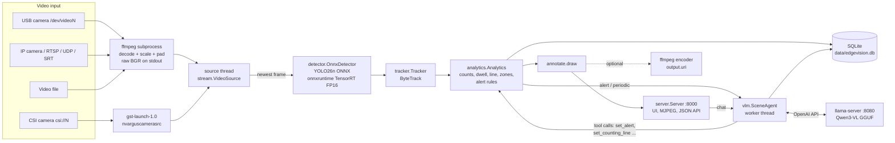

# EdgeVision architecture

This document describes how the code in `edgevision/` works: processes and threads, the per-frame data
flow, the closed loop between the analytics and the vision-language model (VLM), the HTTP API, every
configuration key, and where the time goes. The beginner setup guide is [`../README.md`](../README.md).

## 1. Overview



The same flow as text:

```
 camera / file / stream
        |
  ffmpeg (or gst-launch-1.0 for CSI)  -- separate process, raw BGR frames on a pipe
        |
  [source thread] keeps the newest frame (live) or buffers 8 frames (file)
        |
  [main thread]  detect (ONNX/TensorRT) -> track (ByteTrack) -> analytics -> annotate -> JPEG
        |                    |                          |                         |
        |              alert fired / every N s          |                  [http threads] :8000
        |                    v                          v                   UI, /video.mjpg, /api/*
        |             [vlm thread] --HTTP--> llama-server :8080 (Qwen3-VL)        |
        |                    | tool calls change rules / line                     |
        |                    +-----------------> analytics <---- /commands, chat -+
        v
  SQLite (events, 1-s series, VLM reports, chat)       optional: ffmpeg encoder -> output.uri
```

## 2. Processes and threads

| Unit | Where | What it does |
|---|---|---|
| decoder process | `stream.build_command` | `ffmpeg` (files, network, `/dev/videoN`) or `gst-launch-1.0 nvarguscamerasrc` (`csi://N`). Scales and pads every frame to exactly `source.width x source.height` and writes raw `bgr24` to stdout. |
| `source` thread | `stream.VideoSource._reader` | Reads fixed-size frames from the pipe. **Live sources**: a queue of size 1, so a slow analyser drops old frames (counted in `dropped`) instead of falling behind. **Files**: queue of 8, never drops, so analysing a file is deterministic. Reconnects live sources after `source.reconnect_s`. |
| main thread | `pipeline.Pipeline.run` | Per frame: detector, tracker, analytics, store the 1-s series, annotate, publish JPEG, optional encoder write. Never waits for the VLM. |
| `vlm` thread | `vlm.SceneAgent._worker` | One worker, priority queue: 0 = chat / `/observe`, 1 = alert verification, 2 = periodic scene report. A periodic report is only queued when nothing is pending. |
| `http` thread(s) | `server.Server` | `ThreadingHTTPServer`: one thread per request; each `/video.mjpg` viewer holds one thread. |
| encoder process | `stream.VideoSink` | Only if `output.uri` is set: `ffmpeg -c:v libx264` to a file or rtsp/udp/srt/rtmp. |
| VLM server | `scripts/start_vlm.sh` | `llama-server` (llama.cpp), a separate process, OpenAI-compatible API, `--jinja` so the Qwen3-VL chat template handles tool calls. |

SQLite uses one connection per thread and WAL mode, so the UI and the VLM read while the pipeline writes.

## 3. Per-frame data flow

1. **Decode** (decoder process): any input becomes `H x W x 3` uint8 BGR at `source.width x source.height`
   (aspect ratio kept, padded). `source.fps` resamples with ffmpeg; `source.stride` keeps every Nth frame.
   Without `source.fps`, frames are delivered exactly as decoded (`-fps_mode passthrough`), and file frames carry
   their real media timestamps (ffprobe PTS), so variable-frame-rate phone video is neither padded with
   duplicated frames nor given a drifting clock (on a 5-min VFR test video, index / mean fps was up to 12 s off).
2. **Detect** (`detector.OnnxDetector`): letterbox to the network input size taken from the ONNX file
   (e.g. 544x960), RGB, `/255`, run onnxruntime. Providers are tried in the order of `detector.providers`
   (`tensorrt` -> `cuda` -> `cpu`); the TensorRT engine is built once and cached in `detector.trt_cache`.
   Output `(1, 5, N)` (box + person score) is decoded with greedy NMS (`detector.iou`), boxes mapped back
   to frame pixels. `detector.conf` is low (0.05) on purpose: ByteTrack's second association stage uses
   low-score boxes.
3. **Track** (`tracker.Tracker`): score cut `tracker.min_conf` + class-agnostic NMS `tracker.nms_iou`
   (the same pre-filter as the study), then `trackers.ByteTrackTracker`. Live sources pass the frame
   timestamp, so the motion model uses the real time step even when frames are dropped.
4. **Analytics** (`analytics.Analytics.update`): occupancy, unique people (tracks >= `min_track_s`),
   dwell, line crossings with hysteresis, zone enter/exit, loitering, 1-s time-series bins, heat-map
   counts, and alert-rule evaluation. Emits events (below) that go to SQLite and the UI.
5. **Annotate + publish**: boxes, IDs, line, zones and a status bar are drawn on a copy; the result is
   JPEG-encoded (width <= `server.stream_max_width`) for `/video.mjpg` and kept for the VLM.

Stage times are recorded as `detect_ms`, `track_ms`, `analytics_ms`, `annotate_ms` and `loop_ms`
(visible in `/api/state` -> `pipeline.latency_ms`, and in the run report of `--report out.json`).

### Event kinds (table `events`)

| kind | when | main fields |
|---|---|---|
| `person_enter` | a track becomes a counted person | `track`, `unique` |
| `person_exit` | a counted track unseen for 2 s | `track`, `dwell_s` |
| `line_cross` | foot point changes side of the counting line | `track`, `direction`, totals |
| `zone_enter` / `zone_exit` | foot point enters / leaves a zone polygon | `track`, `zone` |
| `loitering` | a person present longer than `analytics.loiter_s` | `track`, `dwell_s` |
| `alert` | a rule held for `for_s` (and not within `cooldown_s`) | `rule`, `metric`, `value`, `threshold`, `op` |
| `alert_context` | VLM scene report attached to a fired alert (default) | `rule`, `summary`, `anomalies`, `latency_s` |
| `alert_verified` | VLM verdict on an alert (`verify_mode` blind / informed only) | `rule`, `confirmed`, `reason`, `latency_s` |
| `vlm_risk` | a scene report with risk `medium` or `high` | `risk`, `summary`, `anomalies` |
| `config` | a rule or the line was changed (by `/command` or VLM tool) | `change`, details |

### Alert metrics

`occupancy`, `unique_people`, `crossings_total`, `crossings_a_to_b`, `crossings_b_to_a`,
`crossings_last_min`, `max_dwell_s`, `loitering`, `zone:<name>`; operators `>`, `>=`, `<`, `<=`, `==`.
The `/alert` command accepts all of them; the VLM's `set_alert` tool offers the subset `occupancy`,
`unique_people`, `crossings_total`, `crossings_last_min`, `max_dwell_s`, `loitering` with `> >= < <=`.

## 4. The closed loop

```
   pixels --> detector --> tracker --> analytics (numbers = source of truth for counts)
                                          |  ^
                     numbers + events +   |  |  tool calls change the rules and the line;
                     current frame        v  |  they apply from the next frame on
                                   Qwen3-VL (llama-server)
                                          ^
                                          |  questions / commands
                                       operator (web UI or tools/chat_cli.py)
```

1. **Observe** - every `vlm.observe_every_s` seconds the VLM receives the current annotated frame plus
   the analytics snapshot and writes a JSON scene report (`summary`, `activities`, `anomalies`, `risk`).
   Stored in `observations`; `medium`/`high` risk also creates a `vlm_risk` event.
2. **On alert** - when an alert fires and `vlm.verify_alerts` is true, the default `vlm.verify_mode: describe`
   makes the VLM write a scene report for the alert (`alert_context` event). The rule itself is decided by
   the detector numbers only. The yes/no verdict modes `blind` / `informed` (`alert_verified` event) exist
   for research but are unreliable for count alerts: informed confirmed 100 % of fabricated alerts, blind
   was below chance (`results/vlm/e5_verify.json`).
3. **Ask** - two stages, because with the frame attached the 2B model called tools on 75 % of plain
   questions (text-only: 6 %, `results/vlm/e3_tools.json`):
   - *routing*: the question as text, the analytics context (snapshot, last 10 min summary, last scene
     reports) and up to `vlm.history_turns` previous turns, with the tools; at most 3 tool rounds;
   - *answer*: the frame + the question + the executed tool calls (succeeded / failed), the last 2 turns,
     no tools.

   Tools:

   | tool | effect |
   |---|---|
   | `get_history(minutes)` | occupancy summary + event counts from SQLite |
   | `get_recent_events(minutes, kind)` | event list |
   | `set_alert(metric, op, value, for_s, name)` | create / replace a rule (validated) |
   | `remove_alert(name or "all")` | delete rules |
   | `set_counting_line(x1, y1, x2, y2)` | move the line (normalised 0-1) |

   Every change is validated by `Analytics` and logged as a `config` event, so the UI shows what the model
   did. Messages starting with `/` never reach the VLM (deterministic commands, below), so the system
   stays usable if the model is offline or misbehaves.

   **Guardrails** (deterministic, around the model; added after the recorded demo, `results/edge/demo/`):
   - `intent_error`: a `set_counting_line` call that contradicts "horizontal" / "vertical" in the request is
     refused with a corrective hint, so the model retries instead of moving the line wrongly;
   - `fallback_intents`: unambiguous commands ("remove all alerts", "horizontal/vertical line at 75 % /
     the middle / one third") are executed by rule when the model did not already succeed (`source:
     "fallback"` in the action list);
   - a system footer `[system] Changed: ... / No settings were changed.` is appended to every answer to a
     control request, so the reported state is true whatever the model writes; chat history stores the
     model's words without the footer (a 2B model copies it otherwise).
   Measured on 45 utterances through the deployed agent: tool selection 0.91, exact arguments 0.83, false
   tool calls on plain questions 0.06 (`results/vlm/e3b_tools_deployed.json`).

### Chat commands (`edgevision/commands.py`)

| command | effect |
|---|---|
| `/help` | list commands |
| `/stats` | live measurements (JSON) |
| `/history [minutes]` | occupancy summary + event counts (default 10 min) |
| `/events [minutes]` | recent events |
| `/alerts` | list rules |
| `/alert <metric> <op> <value> [for <s>]` | add a rule, e.g. `/alert occupancy > 10 for 5` |
| `/unalert <name\|all>` | remove rule(s); `/unalert` alone only prints the usage |
| `/line x1 y1 x2 y2` | move the counting line, normalised 0-1 |
| `/observe` | ask the VLM for a scene report now |

## 5. HTTP API (port `server.port`, default 8000)

| method | path | returns |
|---|---|---|
| GET | `/` | operator UI (live video, chart, chat, VLM reports, rules, events) |
| GET | `/video.mjpg` | annotated live video, MJPEG |
| GET | `/snapshot.jpg` | latest annotated frame (503 until the first frame) |
| GET | `/api/state` | `measurements` (analytics snapshot), `pipeline` (fps, frames, latency, dropped, provider), `vlm` (online, busy, pending, last latency), `observations` |
| GET | `/api/series?seconds=600` | 1-s occupancy bins: `t`, `occ_mean`, `occ_max`, `unique`, `crossings` |
| GET | `/api/events?minutes=10` | stored events |
| GET | `/api/chat` | last 50 chat messages |
| POST | `/api/chat` | body `{"message": "..."}` -> `{"answer", "actions", "latency_s", ...}` |

Example: `curl -s http://<jetson-ip>:8000/api/state | python3 -m json.tool`;
`curl -s -X POST -H 'Content-Type: application/json' -d '{"message":"/stats"}' http://<jetson-ip>:8000/api/chat`.

The server has **no authentication**: anyone who can reach port 8000 can watch the video and change alert
rules. Keep it on a trusted network (or bind `server.host: 127.0.0.1` and use an SSH tunnel).

## 6. SQLite schema (`store.path`)

```
events(id, wall, ts, kind, data JSON)
series(wall, ts, occ_mean, occ_max, unique_people, crossings)          -- one row per closed 1-s bin
observations(id, wall, ts, trigger, text, data JSON, latency_s)        -- VLM reports and verdicts
chat(id, wall, role, text, data JSON)
```
`wall` is Unix time, `ts` is media time (files) or seconds since start (live).

## 7. Configuration reference

`config.load()` starts from `DEFAULTS` in `edgevision/config.py`, deep-merges the YAML file
(`--config`), then applies `--set key.path=value` overrides (values are parsed as YAML, e.g.
`--set vlm.enabled=false`, `--set detector.providers=[cuda,cpu]`). Relative paths in `detector.weights`,
`detector.trt_cache`, `store.path` and `output.uri` are resolved against the `edge_deploy/` folder;
`source.uri` is passed to ffmpeg as is, so a relative file path there is relative to the current directory.

| key | default | meaning |
|---|---|---|
| `source.uri` | `rtsp://127.0.0.1:8554/cam1` | input: file path, `rtsp://`, `rtsps://`, `rtmp://`, `udp://`, `tcp://`, `srt://`, `rtp://`, `http(s)://`, `/dev/videoN` (USB, also `v4l2:///dev/videoN`) or `csi://N` (Jetson CSI sensor N) |
| `source.width` | `1280` | analysis frame width; frames are scaled (aspect kept) and padded to exactly this size |
| `source.height` | `720` | analysis frame height |
| `source.fps` | `0` | resample to this rate with ffmpeg (`-framerate` for USB cameras, nvarguscamerasrc rate for CSI, default 30 there); 0 = keep the source rate |
| `source.stride` | `1` | keep every Nth decoded frame (cannot be combined with `fps`) |
| `source.realtime` | `null` | `null` = auto: live sources drop stale frames, files never drop; `true` on a file also reads it at real speed (`-re`) |
| `source.loop` | `false` | files: restart at the end |
| `source.rtsp_transport` | `tcp` | RTSP transport for ffmpeg (`tcp` or `udp`) |
| `source.reconnect_s` | `2.0` | live sources: wait this long before reconnecting |
| `source.start_s` | `0.0` | files: start offset in seconds |
| `source.duration_s` | `0.0` | files: analyse only this many seconds (0 = all) |
| `source.hwaccel` | `""` | ffmpeg `-hwaccel` value, e.g. `cuda` on a desktop with NVDEC-enabled ffmpeg (Jetson's apt ffmpeg has no NVDEC) |
| `source.input_args` | `[]` | extra ffmpeg input arguments, verbatim (e.g. `["-input_format", "mjpeg"]` for USB cameras) |
| `detector.backend` | `onnxruntime` | `onnxruntime` (ONNX, no PyTorch) or `ultralytics` (.pt/.onnx/.engine, needs PyTorch) |
| `detector.weights` | `models/yolo26n_person_736x1280.onnx` | model file; 544x960 and 384x640 exports are also provided |
| `detector.providers` | `[tensorrt, cuda, cpu]` | onnxruntime execution providers in order of preference; unavailable ones are skipped |
| `detector.fp16` | `true` | TensorRT FP16 (and `half` for ultralytics) |
| `detector.conf` | `0.05` | minimum detection score kept (low on purpose for ByteTrack) |
| `detector.iou` | `0.7` | NMS IoU threshold |
| `detector.max_det` | `300` | maximum detections per frame |
| `detector.trt_cache` | `models/trt_cache` | TensorRT engine + timing cache directory (board-specific, never copy between devices) |
| `tracker.min_conf` | `0.2` | detections below this score are not given to the tracker |
| `tracker.nms_iou` | `0.6` | extra class-agnostic NMS before tracking (0 = off) |
| `tracker.track_activation_threshold` | `0.7` | score needed to start a new track |
| `tracker.high_conf_det_threshold` | `0.4` | ByteTrack split between first (high) and second (low) association |
| `tracker.lost_track_buffer` | `30` | how long a lost track is kept, in 30-fps frames (30 = 1 s) |
| `tracker.minimum_iou_threshold` | `0.4` | minimum IoU to match a detection to a track |
| `tracker.minimum_consecutive_frames` | `3` | frames before a track is confirmed (gets an ID) |
| `analytics.line` | `[[0.5, 0.0], [0.5, 1.0]]` | counting line, two points in normalised image coordinates (x right, y down) |
| `analytics.line_hysteresis` | `0.3` | a side only counts once the foot point is this many box heights past the line |
| `analytics.zones` | `{}` | named polygons, e.g. `{door: [[0.1,0.6],[0.3,0.6],[0.3,1.0],[0.1,1.0]]}` (normalised) |
| `analytics.min_track_s` | `0.25` | tracks shorter than this are not counted as people (converted to frames with the source fps) |
| `analytics.bin_s` | `1.0` | time-series bin length (s) |
| `analytics.history_s` | `3600` | in-memory time-series length (s); SQLite keeps everything |
| `analytics.heatmap_grid` | `[32, 18]` | foot-point heat-map grid (`GET /heatmap.jpg` renders it over the latest frame) |
| `analytics.loiter_s` | `30.0` | presence longer than this raises a `loitering` event |
| `alerts` | `[{name: crowding, metric: occupancy, op: ">", value: 20, for_s: 3, cooldown_s: 60}]` | initial alert rules (`name`, `metric`, `op`, `value` required; `for_s` default 0, `cooldown_s` default 60); editable at runtime |
| `vlm.enabled` | `true` | use the VLM (observe / verify / chat); `/commands` work either way |
| `vlm.endpoint` | `http://127.0.0.1:8080/v1` | OpenAI-compatible base URL (llama.cpp, Ollama, vLLM, ...) |
| `vlm.model` | `qwen3-vl-2b` | model name sent in requests (llama-server alias set by `start_vlm.sh`: `qwen3-vl-2b` / `qwen3-vl-4b`) |
| `vlm.api_key` | `""` | bearer token, if the server needs one |
| `vlm.timeout_s` | `180` | HTTP timeout per VLM call |
| `vlm.max_tokens` | `384` | answer length limit for chat (reports use 256, verdicts 128) |
| `vlm.temperature` | `0.2` | sampling temperature |
| `vlm.image_max_side` | `896` | the frame is downscaled so its longer side is at most this (fewer image tokens = faster) |
| `vlm.observe_every_s` | `120` | periodic scene report interval (0 = off) |
| `vlm.verify_alerts` | `true` | involve the VLM when an alert fires (see `vlm.verify_mode`) |
| `vlm.verify_mode` | `describe` | `describe` = scene report for the alert, no verdict (default); `blind` / `informed` = yes/no verdict (unreliable for count alerts, E5) |
| `vlm.history_turns` | `6` | previous chat turns sent with each question |
| `vlm.use_tools` | `true` | offer the tools (closed loop); `false` = plain question answering |
| `vlm.image` | `annotated` | frame sent to the VLM: `annotated` (boxes + IDs) or `raw` |
| `server.enabled` | `true` | run the web UI / API |
| `server.host` | `0.0.0.0` | bind address (`0.0.0.0` = reachable from the network) |
| `server.port` | `8000` | HTTP port |
| `server.jpeg_quality` | `80` | MJPEG quality |
| `server.stream_max_width` | `960` | MJPEG frames are downscaled to this width |
| `server.token` | `""` | if set, every request needs `?token=...` or header `X-Token` (open the UI as `http://host:8000/?token=...`) |
| `source.decoder` | `ffmpeg` | `gstreamer` decodes `rtsp://` / `udp://` H.264 with GStreamer (hardware `nvv4l2decoder` on Jetson) |
| `source.gst_decoder` | `nvv4l2decoder` | GStreamer decoder element (`avdec_h264` for software decoding elsewhere) |
| `output.uri` | `""` | optional annotated re-stream / recording: `rtsp://`, `udp://`, `srt://`, `rtmp://`, `tcp://` or a file path (`.mp4`) |
| `output.fps` | `15` | encoder frame rate (0 = source fps) |
| `output.bitrate` | `2M` | encoder bitrate |
| `store.path` | `data/edgevision.db` | SQLite file (`:memory:` for tests) |
| `log_level` | `INFO` | Python logging level |

Command-line options of `python -m edgevision`: `--config FILE` (default `configs/desktop.yaml`),
`--set KEY=VALUE` (repeatable), `--max-frames N`, `--report out.json` (latency per stage, throughput,
final analytics), `--dump-tracks out.npz` (per-frame tracks and raw detections for offline scoring).

## 8. Latency budget

The analysis loop is sequential: `loop_ms ~= detect_ms + track_ms + analytics_ms + annotate_ms` (+ JPEG
encode). To keep up with a live source at `source.fps` the loop must finish within `1000 / fps` ms
(66.7 ms at the 15 fps of `configs/jetson.yaml`). If it does not, the live queue drops frames (the
`dropped` counter rises) and the effective analysis rate falls; nothing lags behind the camera.

Where the time goes, and what to change:

| stage | depends on | knobs |
|---|---|---|
| decode (separate process, CPU) | camera resolution and codec | use a 720p sub-stream of the IP camera; `source.fps` |
| `detect_ms` (GPU) | network input size, power mode, GPU sharing with the VLM | 544x960 or 384x640 model; `nvpmodel` MAXN; TensorRT FP16 |
| `track_ms` (CPU) | number of boxes | `tracker.min_conf` |
| `annotate_ms` + JPEG (CPU) | frame size, number of UI viewers | `server.stream_max_width`, `server.jpeg_quality`, `server.enabled: false` |
| VLM (asynchronous) | image tokens, prompt length, model size | `vlm.image_max_side`, `CTX`, 2B vs 4B, `vlm.observe_every_s` |

The VLM never blocks the loop, but on a Jetson it shares the same GPU and memory: while it is
prefilling an image or generating, `detect_ms` is expected to increase. Measure on your own board:
`scripts/04_warmup_detector.sh` (detector alone), then a run with `--report`:

```bash
python3 -m edgevision --config configs/jetson.yaml --set source.uri=data/aa1.mp4 \
    --set server.enabled=false --max-frames 1500 --report data/report.json
```

Reference only (measured on the development desktop, RTX 4060 Laptop GPU, not a Jetson):
`../results/latency.json` reports a 3.68 ms median for the study's YOLO26n FP16 configuration (PyTorch/Ultralytics, GPU pre-processing + NMS),
and `../results/model_selection.json` CPU onnxruntime medians of ~152 / 96 / 60 ms for the 736x1280 /
544x960 / 384x640 exports. Jetson numbers must be measured with the commands above.
